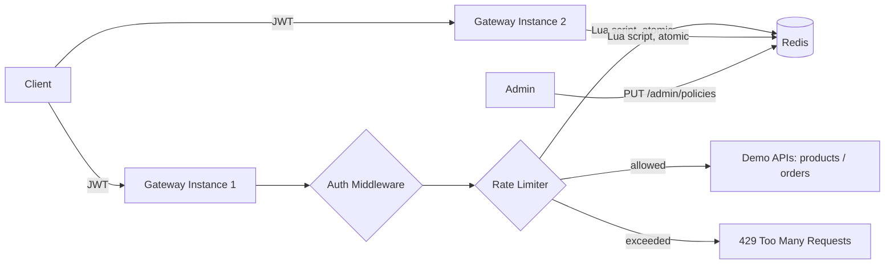

# RateShield: Distributed API Rate Limiting Gateway

Node.js + Express gateway that protects APIs with a Redis-backed Token Bucket
rate limiter. JWT auth, per-user/per-endpoint policies, dynamic config, HTTP 429.

## Architecture



## Setup

```bash
git clone <repo-url> && cd RateShield
cp .env.example .env
docker compose up -d
npm install
npm run dev
```

## API

| Method | Endpoint          | Auth         | Description              |
| ------ | ----------------- | ------------ | ------------------------ |
| GET    | /health           | none         | Health + Redis check     |
| POST   | /auth/token       | none         | Body `{"userId":"alice"}`|
| GET    | /api/products     | Bearer JWT   | Rate-limited demo API    |
| GET    | /api/orders       | Bearer JWT   | Rate-limited demo API    |
| GET    | /admin/policies   | x-admin-key  | View policies            |
| PUT    | /admin/policies   | x-admin-key  | Update policies          |

## Rate limit headers

`X-RateLimit-Limit`, `X-RateLimit-Remaining`, `Retry-After` (on 429).

## How it works

Each (user, endpoint) pair has a bucket in Redis (`rl:<user>:<endpoint>`) storing
`tokens` and `last_refill`. A Lua script refills, checks and consumes atomically,
so concurrent requests across multiple gateway instances can't corrupt state.